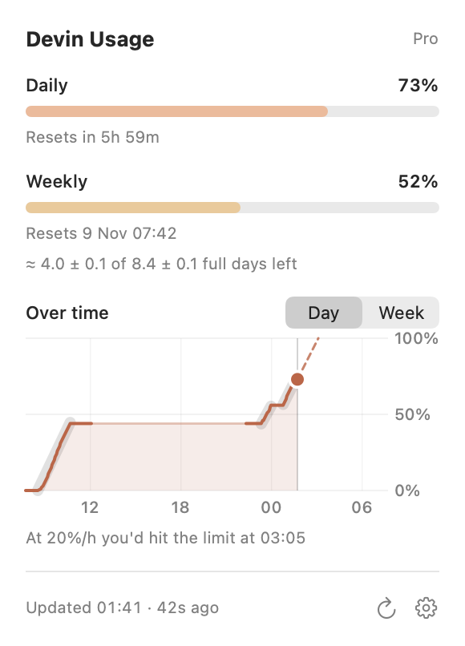

<div align="center">

# Devin Usage

**Your Devin plan usage, always one glance away in the macOS menu bar.**

[](https://github.com/timofeykhodykin/mac-devin-usage/releases/latest)


[](LICENSE.md)

<picture>
  <source media="(prefers-color-scheme: dark)" srcset="docs/dropdown-dark.png">
  
</picture>

<picture>
  <source media="(prefers-color-scheme: dark)" srcset="docs/menubar-dark.png">
  
</picture>

[**Download**](https://github.com/timofeykhodykin/mac-devin-usage/releases/latest) ·
[How it works](#how-it-works) ·
[Changelog](CHANGELOG.md)

</div>

## Features

- **Daily usage in the menu bar**, like `37%`, or daily and weekly together: `37% / 64%`.
- **Both limits one click away**, with progress bars and reset times.
- **Days left this week.** It learns how much of the weekly limit a full daily limit
  uses and shows how many full days are left, with a margin of error:
  `≈ 3.4 ± 0.2 of 7.5 ± 0.3 full days left`. Recent use counts most, and it notices when
  the limits change.
- **Usage over time.** A chart of the current day or week, with the pace of each stretch
  of use, where the current pace leads by the reset, and an even-pace line for the week.
  Can be turned off in Settings.
- **Never goes stale on its own.** It re-reads the Devin sign-in saved by Devin Desktop
  or the Devin CLI on every refresh — read-only, it never changes or refreshes it.
- **Gentle on rate limits.** It calls the usage API only as often as your refresh
  interval, and backs off exponentially on HTTP 429.
- **Honest when offline.** If usage can't be fetched, the menu bar shows `?` and the
  dropdown keeps the last known numbers.
- **Native and tiny.** Swift and SwiftUI, no dependencies, no telemetry.

## Install

You need macOS 15 or later and a Devin plan with daily/weekly quota, signed in through
[Devin](https://devin.ai) Desktop or the [Devin CLI](https://docs.devin.ai/cli).

1. Download `Devin-Usage-X.Y.Z.zip` from the
   [latest release](https://github.com/timofeykhodykin/mac-devin-usage/releases/latest),
   unzip it, and move **Devin Usage** to Applications.
2. Open it. The app isn't notarized, so macOS blocks the first launch: go to
   **System Settings → Privacy & Security** and click **Open Anyway**.
3. Optional: in Settings (the gear in the dropdown), turn on **Launch at login**.

<details>
<summary><b>Build from source</b></summary>

<br>

Requires Xcode or the Command Line Tools (`xcode-select --install`).

```bash
git clone https://github.com/timofeykhodykin/mac-devin-usage.git
cd mac-devin-usage
./scripts/build-app.sh --install
```

This builds the app, copies it to `~/Applications`, and launches it. A build made on your
own Mac opens without the Gatekeeper prompt.

</details>

<details>
<summary><b>Uninstall</b></summary>

<br>

Quit the app and delete it. It never wrote anything to Devin's files, so nothing needs
restoring.

</details>

## How it works

<details>
<summary><b>The sign-in: read-only, never refreshed</b></summary>

<br>

Devin Desktop keeps its API key in its VS Code-style state database
(`~/Library/Application Support/Devin/User/globalStorage/state.vscdb`, the
`windsurfAuthStatus` row), and the Devin CLI keeps one in
`~/.local/share/devin/credentials.toml`. The app reads the key from Desktop first,
then the CLI — the database is opened read-only and only the `apiKey` and
`apiServerUrl` fields are extracted, never the whole record.

Because it re-reads on every refresh, a fresh sign-in or a rotated key is picked up at
once; on `HTTP 401` it re-reads once more in case a newer key appeared. It never writes
to Devin's files, never refreshes a token, and never logs the key — so it can't break
your Devin sign-in.

</details>

<details>
<summary><b>Where the numbers come from</b></summary>

<br>

The app polls the same endpoint Devin's integrations use:

```
POST {apiServerUrl}/exa.seat_management_pb.SeatManagementService/GetUserStatus
```

with the API key in the request metadata. The response carries the plan name and the
daily and weekly quota as *remaining* percentages plus their reset times; the app shows
`100 − remaining`, clamped to 0…100. Plans billed per credit report no quota — the app
says so instead of showing zeros.

Its rate limits aren't documented, so it's polled only on your refresh interval (10
seconds to 30 minutes, default 30 seconds). On `HTTP 429` it backs off exponentially,
up to 30 minutes.

Every change of either percentage goes into a local history. The days-left estimate
compares how much the weekly and the daily percentages grew between consecutive readings
in the same windows: if 60% of a day cost 8% of the week, a full day costs about 13% and
the week holds about 7.5. A day from a week ago counts half as much as today's, and if
the cost clearly differs before and after some point (the limits changed), older data is
set aside. Percentages come rounded to whole numbers, so it also times the moments the
weekly percentage ticks over: between two ticks the week grew by an exact number of
points, which pins the estimate down after a couple of ticks. The ± is a ~95% range from
the spread between days and that rounding; while it's wide, the dropdown shows a range,
or waits.

</details>

## Privacy

- Talks only to `server.codeium.com`, or the https API server your Devin sign-in names.
- The API key is only read where Devin keeps it: never logged, cached to disk, or sent
  anywhere else.
- Writes only its preferences, one usage snapshot and a usage history (percentages and
  reset times, kept 5 weeks) in `~/Library/Application Support/MacDevinUsage/`.

<details>
<summary><b>Troubleshooting</b></summary>

<br>

```bash
/usr/bin/log stream --predicate 'subsystem == "dev.mac-devin-usage"' --info
```

Shows every fetch and credential read. Never shows the API key.

| Message | Meaning |
|---|---|
| `Rate limited …; pausing …` | The usage API returned 429. It clears on its own. |
| `Not signed in to Devin…` | No API key in Devin Desktop's database or the CLI file. Sign in to Devin, or run `devin auth login`. |
| `Devin sign-in expired…` | The stored key was rejected twice. Sign in to Devin again. |

</details>

<details>
<summary><b>Development</b></summary>

<br>

```bash
swift build                    # debug build
./scripts/test.sh              # unit tests (works with the Command Line Tools only)
./scripts/build-app.sh         # universal release app in dist/
./scripts/screenshots.sh       # regenerate docs/*.png from the real views
./scripts/release.sh X.Y.Z     # release a new version
```

Versions follow [Semantic Versioning](https://semver.org). Note each change under
**Unreleased** in [CHANGELOG.md](CHANGELOG.md). `release.sh` turns those notes into the
new version, tags it, and pushes; the tag makes GitHub Actions build the app and publish
the release.

</details>

## License

[PolyForm Noncommercial 1.0.0](LICENSE.md): free for personal and other noncommercial use.
For commercial use, [get in touch](https://github.com/timofeykhodykin).

Unofficial and not affiliated with Cognition. Devin is a trademark of Cognition AI, Inc.
